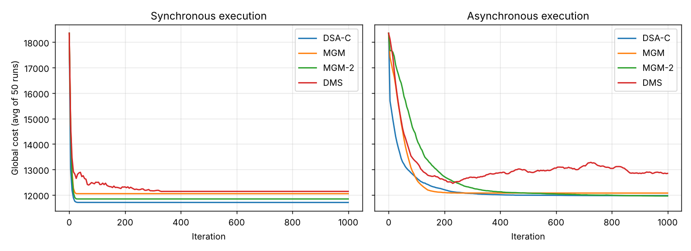

# Multi-Agent Distributed Algorithms

Course project in Distributed Systems (IoT), Ben-Gurion University, 2026. Team project, written in Java.

Two exercises on how independent agents, each seeing only its neighbors, reach a global outcome through local decisions and message passing. Both were implemented in a **synchronous** (round-based) and an **asynchronous** (multi-threaded) version.

## Exercise 1: Distributed routing
`ex1-distributed-routing/`

Each agent maintains a routing table and repeatedly exchanges it with its neighbors, updating whenever it learns a new or shorter path, until the whole network converges.

- Synchronous mode: round-by-round propagation until no table changes.
- Asynchronous mode: one thread per agent, with quiescence detection (no messages in flight and no active workers) to decide when the system has converged.
- Lamport-style logical clocks track the causal depth of the computation.

## Exercise 2: Distributed constraint optimization (DCOP)
`ex2-dcop-local-search/`

Agents choose values to minimize the total cost of the constraints between neighbors. Four algorithms were implemented and compared:

| Algorithm | Idea |
|---|---|
| DSA-C | Each agent changes its value with probability p (here 0.7) when it does not make things worse |
| MGM | Agents exchange their possible gains; only the agent with the largest local gain moves |
| MGM-2 | Like MGM, but pairs of neighbors can coordinate a joint move |
| DMS | Max-Sum message passing with damping (λ = 0.9) |

**Setup:** 50 agents, network density 0.3, domain size 10, constraint costs up to 100, 1,000 iterations, averaged over 50 randomized runs.



**Final global cost after 1,000 iterations** (average of 50 runs, starting cost 18,352):

| Algorithm | Synchronous | Asynchronous |
|---|---|---|
| DSA-C | 11,708 | 11,978 |
| MGM | 12,053 | 12,076 |
| MGM-2 | 11,845 | 11,962 |
| DMS | 12,142 | 12,850 |

Full results: [`results/dcop_results.csv`](ex2-dcop-local-search/results/dcop_results.csv)

## How to run
Compile and run `Main.java` in each folder with any Java 8+ JDK:
```
javac *.java && java Main            # exercise 1
cd src && javac *.java && java Main  # exercise 2
```
